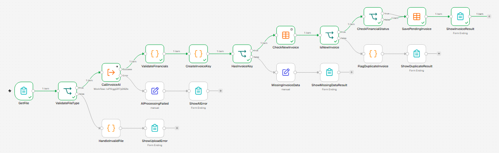
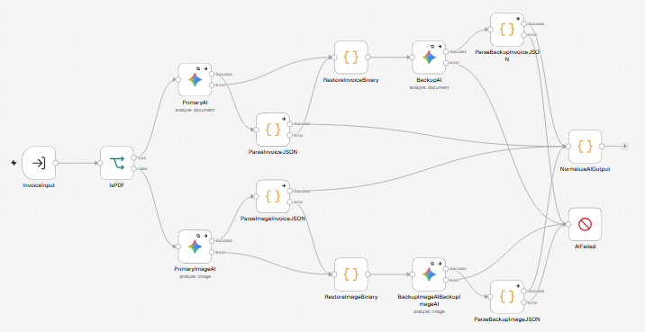
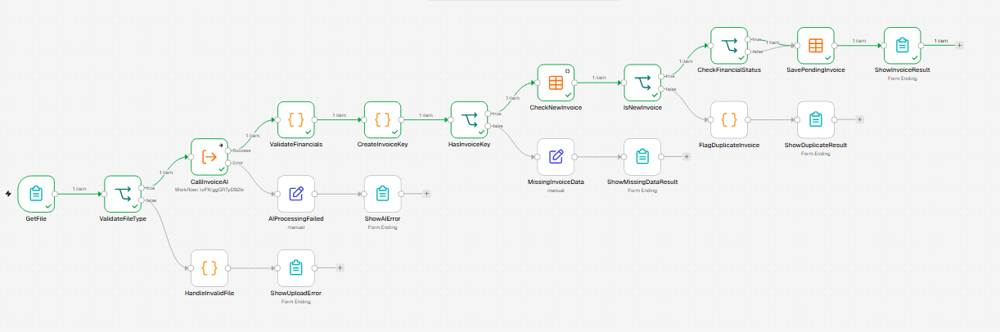
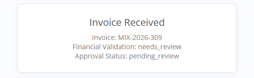
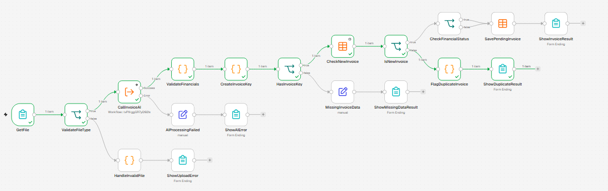
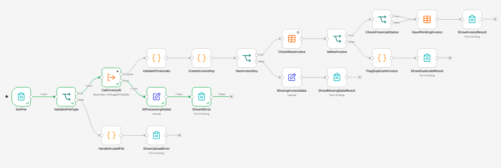
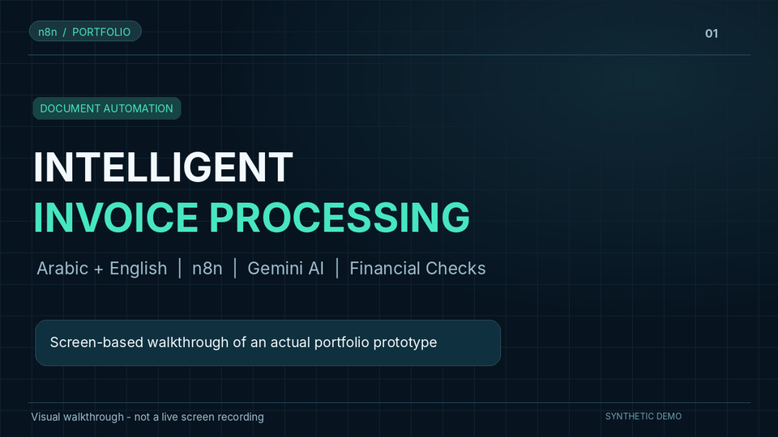
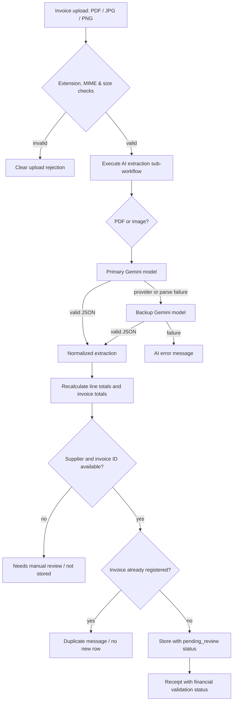

# Intelligent Invoice Processing

**Bilingual Arabic + English invoice extraction, deterministic financial checks, duplicate detection, and resilient AI workflows using n8n.**

[Read in Arabic / README_AR.md](README_AR.md) | [Installation](docs/installation.md) | [All customization options](docs/customization-options.md) | [Technical review](docs/technical-review.md) | [Demo video](demo/invoice-processing-visual-walkthrough.mp4)

> **Portfolio demonstration, not a production accounting system.** The included invoices are synthetic. The core workflows were built and tested locally by the author; the exports were subsequently reviewed with static/offline checks. Screenshots show test runs, not independently audited performance results.

## The business problem

Accounts-payable teams receive invoices as PDFs and images, often in both Arabic and English. Manually reading line items, reconciling totals, checking duplicates, and updating a register can be repetitive and error-prone. This demonstration automates the initial intake and checks while keeping human/business approval separate from extraction.

**Who might use a tailored version?** SMEs, maintenance and facility-management firms, purchasing teams, agencies, finance operations, and larger enterprises after suitable security, integration, and reliability work.

## What is implemented now

| Capability | Current demo behavior |
|---|---|
| Invoice upload | n8n form accepts one invoice per submission |
| Accepted formats | PDF, JPG/JPEG, PNG |
| Upload checks | Consistent extension-to-claimed-MIME mapping and maximum size of 10 MiB |
| Arabic + English | Extracts supplier, invoice ID/date, currency, amounts, and line items from multilingual invoices |
| Primary AI / backup | Two Google Gemini model configurations, with retries and backup routing when extraction/parsing fails |
| Modular design | Separate main workflow and AI-extraction sub-workflow |
| Financial checks | Recomputes each line amount, subtotal, and subtotal + tax, with a 0.02-unit tolerance |
| Duplicate check | Looks up a normalized supplier-name + invoice-number key |
| Data register | New invoices are inserted in n8n `InvoiceRegistry` with `pending_review` |
| User feedback | Distinct form endings for received, duplicate, missing identity, rejected file, and AI failure |
| Validation history | Persists `validation_status` and `validation_issues` for new invoices |

**Important:** `passed` means the arithmetic checks passed; it does **not** mean the invoice is genuine, tax-compliant, purchase-order matched, or approved. All new records remain `pending_review` even when arithmetic passes.

## Evidence from the demonstration

| Main workflow | AI extraction engine |
|---|---|
|  |  |

| Successful processing path | Financial discrepancy example |
|---|---|
|  |  |

| Duplicate path | AI failure path |
|---|---|
|  |  |

**[Watch the screen-based visual walkthrough (MP4)](demo/invoice-processing-visual-walkthrough.mp4)** — an edited overview made from the supplied screenshots. It is **not** a live screen recording, nor evidence of timed performance.

## How the system works

**Model availability:** The exported backup identifier `models/gemini-3.5-flash` was not found in Google’s current model list during the November 2026 review. Confirm availability and select a supported backup model in your own instance before testing. The export is unchanged.

The model extracts the numbers **as printed**. Deterministic JavaScript logic performs the arithmetic checks independently and flags mismatches rather than silently changing amounts.

## Quick start

1. Have a working n8n instance with **Form Trigger**, **Data Table**, **Execute Sub-workflow**, and **Google Gemini** nodes. The demonstration was built on self-hosted n8n.
2. Import [ai-extraction-engine.json](workflows/ai-extraction-engine.json) **first**, then [main-workflow.json](workflows/main-workflow.json).
3. Create a Gemini API credential in your own instance. Assign it to every AI node in the engine; credentials are intentionally absent from public exports.
4. Create the `InvoiceRegistry` Data Table with the exact columns in [data-table-schema.md](docs/data-table-schema.md).
5. In the main workflow, re-select the imported AI engine in `CallInvoiceAI`, and select your new Data Table in `CheckNewInvoice` and `SavePendingInvoice`.
6. Use the Form Trigger **Test URL**, submit a file from `samples/`, and inspect the execution/registry.
7. Confirm the branch outputs before considering publishing or exposing the form externally. After import, confirm image nodes use binary field `invoice_file`.

**Read the detailed [installation guide](docs/installation.md), including import reconnection and security precautions.** Workflow JSON is not a portable copy of credentials, data-table contents, or your local environment.

## Supplied reproducible test data

| Sample | Language | Expected business outcome |
|---|---|---|
| [Invoice 01](samples/Invoice_01_English_Bilingual_Valid.pdf) | English invoice with Arabic line descriptions | Arithmetic passes (`7,000.00 + 980.00 = 7,980.00 EGP`) |
| [Invoice 02](samples/Invoice_02_Arabic_Bilingual_Valid.pdf) | Arabic supplier/invoice with bilingual labels | Arabic extraction and arithmetic verification |
| [Invoice 03](samples/Invoice_03_Mixed_Validation_Error.pdf) | Mixed Arabic/English | `needs_review`: printed total `4,507.30` vs calculated `4,497.30 EGP` |

All three are **fictional demonstration invoices**, not real supplier bills. Additional tests include duplicate submission, unsupported extension, too-large file, missing invoice identity, primary-model failure, and backup behavior. See [test cases](docs/test-cases.md).

## Flexible client-specific deployment

The current prototype uses **self-hosted n8n + Google Gemini API + n8n Data Tables**. Depending on the client's requirements, a future implementation can use **managed cloud**, **client-controlled cloud infrastructure**, or **on-premises/private servers**, with corresponding choices for databases, access controls, and AI inference.

**Data-location distinction:** storing invoices in private infrastructure **does not** make the current solution fully private because Gemini processing sends content to Google's service. Fully private processing would require a validated on-premises/private inference path and end-to-end security review.

## Client customization and optional features

A custom engagement can extend this demonstration with all the capabilities below. **None are represented as already implemented.** See the [complete customization catalog](docs/customization-options.md) and [Arabic catalog](docs/customization-options-ar.md).

| Area | Examples of proposed enhancements |
|---|---|
| Intake | Gmail, Outlook, Google Drive, OneDrive, SharePoint, WhatsApp Business, bulk upload, API/webhooks |
| AI extraction | Different cloud/local providers, OCR pre-processing, structured output contracts, confidence review |
| Financial control | VAT-specific rules, duplicate similarity, supplier checks, PO/receipt matching |
| Approval paths | Human approval; AI approval; independent second AI review; hybrid, risk-based escalation |
| Accounting / ERP | QuickBooks, Xero, Odoo, Zoho Books, SAP or other supported client systems |
| Storage | PostgreSQL, MySQL, cloud object storage, customer-managed databases |
| Notifications | Email, Slack, Teams, Telegram, permitted WhatsApp channels |
| Analytics | Processing queue, volume, exceptions, amounts, cost and accuracy dashboards |
| Finance extras | Multi-currency, payment due-date tracking, cost centers, GL classification |
| Security | Role-based permissions, audit trails, encryption, retention and data residency |
| Scale | Queues, concurrency, monitoring, retries, backups, disaster recovery |

### Approval models are selectable, not a promise of zero errors

- **Human approval:** a reviewer corrects and accepts/rejects each invoice.
- **AI-assisted approval:** the AI recommends an outcome against explicit business rules; manual oversight can be required.
- **Two-stage AI review:** a second reviewer evaluates the first decision and flags disagreements; independence and measured calibration matter.
- **Hybrid risk-based approval:** automatically route low-risk candidates only after evaluation; send exceptions/high-value invoices to people.

**No AI-only configuration can credibly guarantee near-zero error or zero risk without representative measurement and controls.** A second model can repeat the first model's mistake. Financial and policy rules should remain deterministic where possible.

## Honest limitations and production checklist

- One document is processed per form submission; no batch queue in this export.
- The backup models share the **same Gemini provider and credential**. They cannot resolve a provider-wide outage, shared quota exhaustion, or revoked key.
- Detection is based on name + invoice number and is **not** a database-enforced unique constraint; concurrent submissions and supplier-name variants need additional controls.
- File extension and MIME consistency checks are **not** malware scanning or file signature verification.
- AI outputs are parsed as JSON but are not fully validated against a typed extraction schema. OCR/transcription errors remain possible.
- The default form is not configured as an externally secured production endpoint.
- Human/AI approval, ERP posting, payment processing, advanced tax compliance, audit logging, true private inference, and customer-facing dashboards are **not implemented**.
- Local runtime screenshots and workflow graph review are **not** independent security, load, financial, or regulatory certification.

Please review [security and deployment](docs/deployment-and-security.md), [static review findings](docs/technical-review.md), and [testing](docs/test-cases.md) before any real financial use.

## Stack and references

**n8n self-hosted**, built-in Form/Data Table/Execute Sub-workflow/Code nodes, **Google Gemini 3.5 Flash-Lite** (primary), **Gemini 3.5 Flash** (backup), JavaScript for deterministic validation, and PDF/image samples. Gemini usage and commercial deployment may incur model, storage, infrastructure, and service charges depending on client setup and current terms.

- [n8n workflow export/import](https://docs.n8n.io/workflows/export-import/)
- [n8n sub-workflows](https://docs.n8n.io/flow-logic/subworkflows/)
- [n8n Data Tables](https://docs.n8n.io/integrations/builtin/core-nodes/n8n-nodes-base.datatable/)
- [Google Gemini models](https://ai.google.dev/gemini-api/docs/models)
- [Gemini API pricing](https://ai.google.dev/gemini-api/docs/pricing)

## Request a tailored solution

**Ahmed Negm — AI Automation & n8n Workflows**

[Portfolio](https://alive-paprika-ffc.notion.site/Ahmed-Negm-41979ae387808083b153e28e919d0919) | [LinkedIn](https://www.linkedin.com/in/ahmedmamdouhnegm/)

Tell me your invoice intake channels, monthly volume, ERP/accounting software, approval rules, hosting/privacy constraints, and integration needs. Use the [client requirements checklist](docs/client-requirements.md) as a starting point.

---

**Repository use:** No software license is included by default; select an appropriate license and publish intentionally before distributing software for third-party use. The examples are synthetic and do not establish guaranteed financial outcomes.
