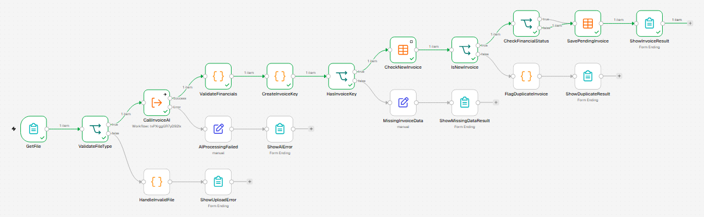
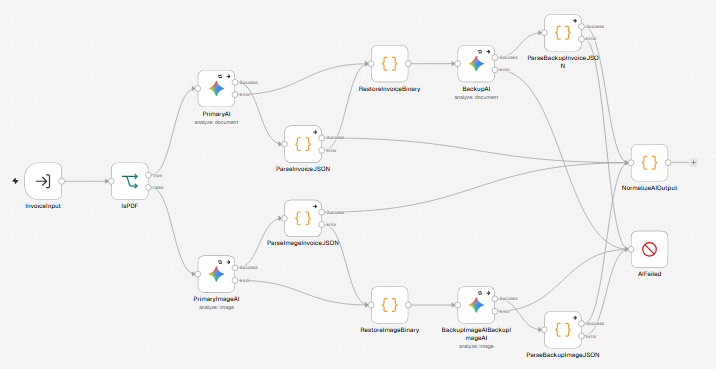
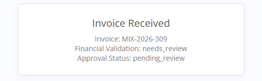
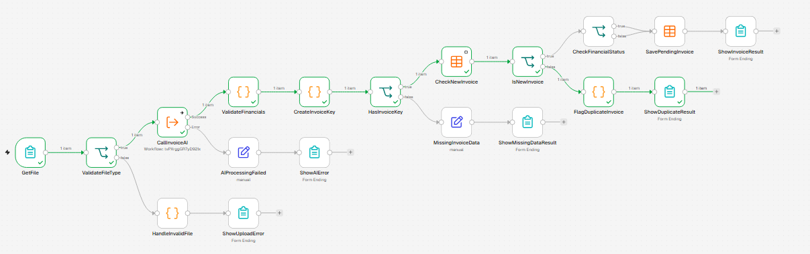
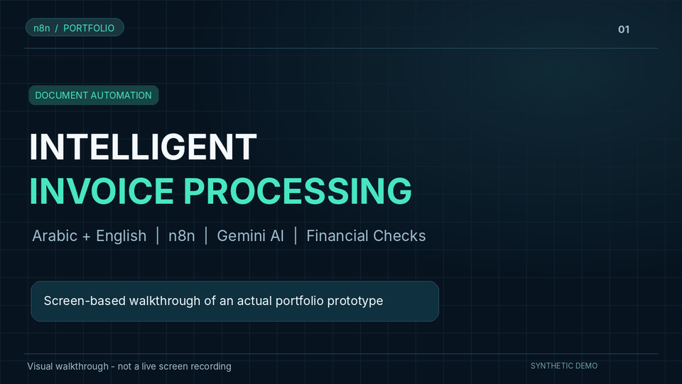

# نظام معالجة الفواتير الذكي | Intelligent Invoice Processing

**مشروع عملي باستخدام n8n لاستخراج بيانات الفواتير العربية والإنجليزية، ومراجعة الحسابات، واكتشاف التكرار، والتعامل مع أخطاء الملفات والذكاء الاصطناعي.**

[English README](README.md) · [دليل التشغيل](docs/installation.md) · [كل التخصيصات والإضافات بالعربي](docs/customization-options-ar.md) · [فيديو توضيحي](demo/invoice-processing-visual-walkthrough.mp4)

> **تنبيه:** ده مشروع Portfolio تجريبي مبني على فواتير وهمية، مش نظام محاسبي معتمد للاستخدام الإنتاجي بدون إعدادات واختبارات إضافية. الصور والفيديو بيوضحوا التشغيل التجريبي، ومش دليل على نتائج فعلية لدى عميل.

## المشكلة اللي بيحلها المشروع

الشركات بتستقبل فواتير بصيغ مختلفة، أحيانًا عربية وإنجليزية في نفس المستند. إدخال اسم المورد، رقم الفاتورة، الأصناف، الكميات والمبالغ يدويًا بياخد وقت، وممكن تحصل أخطاء حسابية أو تتسجل نفس الفاتورة مرتين.

المشروع بينفذ **مرحلة الاستقبال والاستخراج والفحص والتسجيل المبدئي**. مش بيصدر موافقة مالية تلقائية، ومش بيحول المبالغ أو يسجل قيود محاسبية داخل ERP.

## المميزات المنفذة فعلًا

| الميزة | السلوك الحالي |
|---|---|
| رفع الفواتير | Form داخل n8n، فاتورة واحدة لكل طلب |
| الصيغ المدعومة | PDF وJPG وJPEG وPNG |
| التحقق من الملفات | الامتداد وMIME Type المعلن وحجم حتى 10 MiB |
| الفواتير العربية والإنجليزية | استخراج المورد ورقم وتاريخ الفاتورة والعملة والأصناف والكميات والأسعار والإجماليات |
| Primary AI + Backup AI | موديلان من Google Gemini مع Retry والتحويل للاحتياطي عند الفشل |
| تصميم Modular | Workflow رئيسي وSub-workflow منفصل لمعالجة AI |
| مراجعة حسابية مستقلة | التأكد من الكمية × السعر، مجموع البنود، والإجمالي مع الضريبة |
| كشف الفواتير المكررة | مفتاح موحد من اسم المورد ورقم الفاتورة |
| سجل الفواتير | تخزين الفاتورة الجديدة في Data Table اسمها InvoiceRegistry |
| إدارة الحالات | passed أو needs_review مع بقاء approval_status = pending_review |
| معالجة الأخطاء | رسائل للملفات المرفوضة، والأخطاء الحسابية، والتكرار، وغياب البيانات، وفشل AI |

**معنى passed هنا إن الحسابات متوافقة طبقًا لقواعد المشروع، مش إن الفاتورة صحيحة قانونيًا أو أصلية أو معتمدة ماليًا.**

## شكل النظام

1. المستخدم بيرفع فاتورة PDF أو صورة.
2. النظام بيتحقق من النوع والحجم.
3. محرك Gemini يستخرج الحقول العربية والإنجليزية مع الحفاظ على الأرقام الإنجليزية 0-9.
4. كود JavaScript بيراجع العمليات الحسابية بعيدًا عن قرار AI.
5. النظام بيتحقق من اسم المورد ورقم الفاتورة ومن وجود نسخة سابقة.
6. الفاتورة الجديدة بتتسجل بحالة pending_review، وبيظهر للمستخدم ملخص النتيجة.

## أمثلة الاختبار

| المثال | النتيجة المتوقعة |
|---|---|
| [Invoice 01](samples/Invoice_01_English_Bilingual_Valid.pdf) | فاتورة إنجليزية وبنود عربية، الإجمالي 7,980.00 EGP، والحسابات سليمة |
| [Invoice 02](samples/Invoice_02_Arabic_Bilingual_Valid.pdf) | فاتورة عربية/إنجليزية، الإجمالي 5,198.40 EGP |
| [Invoice 03](samples/Invoice_03_Mixed_Validation_Error.pdf) | خطأ مقصود: المكتوب 4,507.30 EGP والصحيح حسابيًا 4,497.30 EGP؛ الحالة needs_review |

كل الملفات **بيانات اختبار وهمية** ولا تخص شركات أو عملاء حقيقيين.

### لقطات من التشغيل

[**شاهد الفيديو التوضيحي MP4**](demo/invoice-processing-visual-walkthrough.mp4) — فيديو عرض مبني على Screenshots الفعلية، **مش تسجيل تشغيل حي**.

## إزاي تشغّل المشروع؟

1. جهّز n8n على Docker أو بيئة مناسبة، وتأكد من دعم Google Gemini وData Tables.
2. استورد ملف **ai-extraction-engine.json** الأول من مجلد workflows.
3. اربط Gemini API Credential الخاصة بيك داخل عقد AI؛ المفاتيح مش متضمنة في ملفات GitHub.
4. أنشئ Data Table اسمها **InvoiceRegistry** بالأعمدة الموجودة في [الدليل](docs/data-table-schema.md).
5. استورد **main-workflow.json** بعد كده.
6. افتح CallInvoiceAI واختار الـSub-workflow المستورد، وبعدها اربط عقد Data Table بالجدول الجديد.
7. اختبر الفواتير الوهمية من مجلد samples قبل نشر أي Form للاستخدام العام.

**ملحوظة:** كل Workflow بيتصدّر كملف JSON مستقل. ملف الـMain مش بيضم كود الـSub-workflow جواه، ولا Credentials أو بيانات قاعدة البيانات بتنتقل تلقائيًا.

[الدليل التفصيلي للتثبيت](docs/installation.md)

## التخصيص حسب احتياج العميل

إحنا مش بنقدم Workflow واحد ثابت؛ نقدر **نطوّر نسخة جديدة حسب احتياج الشركة**:

- **مصادر الفواتير:** Gmail وOutlook وGoogle Drive وOneDrive وSharePoint وWhatsApp Business والـWebhooks ورفع دفعات.
- **AI وOCR:** تغيير مزود الذكاء الاصطناعي، تشغيل موديل محلي، تحسين قراءة الصور والفواتير العربية، وقياس دقة الاستخراج.
- **الحسابات:** مراجعة VAT، التحقق من المورد، اكتشاف التشابه، مطابقة Purchase Orders وإثبات الاستلام.
- **الموافقات:** Human Approval أو AI Approval أو **AI Approval وبعده AI Reviewer مستقل**، أو نظام Hybrid يرسل الحالات الحساسة للموظف.
- **المحاسبة:** QuickBooks وXero وOdoo وZoho Books وأنظمة ERP أخرى طبقًا للتكاملات المتاحة.
- **التخزين:** PostgreSQL وMySQL وCloud Storage أو قواعد بيانات وخوادم خاصة بالعميل.
- **الإشعارات:** Email وSlack وTeams وTelegram والقنوات المتاحة رسميًا.
- **التقارير:** Dashboards، أخطاء الفواتير، التكاليف، السرعة، نسب الرفض، وتقارير الموردين.
- **العمليات المالية:** Multi-Currency، متابعة الاستحقاق، تصنيف المصروفات والتكاليف والمشروعات.
- **الأمان:** صلاحيات وAudit Logs وتشفير وسياسات احتفاظ وإقامة البيانات.
- **الاعتمادية:** Queues وMonitoring وRetry وBackup والتعامل الآمن مع ملفات متزامنة.
- **اللغة والفروع:** واجهات RTL، تعدد الشركات والفروع والعملات والقواعد المحلية.

**[القائمة الكاملة لكل Client Customization & Optional Features بالعربي](docs/customization-options-ar.md)**

### Human Approval ولا AI Approval؟

الاتنين خيارات متاحة **للتنفيذ مستقبلًا**، ومش موجودين في النسخة التجريبية الحالية. العميل يقدر يختار مراجعة بشرية، أو توصية AI مع موافقة موظف، أو موافقة آلية لفئات منخفضة المخاطر، أو مرحلتين منفصلتين من AI مع مراجعة بشرية عند الاختلاف.

وجود **AI Reviewer ثاني لا يضمن أخطاء شبه صفر**؛ لازم نقيس النتيجة على فواتير مصرح باستخدامها، ونضيف ضوابط مستقلة وتصعيدًا بشريًا للحالات المهمة.

### Cloud ولا Private / On-Premises؟

يمكن تصميم نسخة تعمل على Cloud، أو على Cloud خاص بالعميل، أو على خوادمه وقواعد بياناته الداخلية. لكن **تشغيل n8n على سيرفر خاص لا يجعل المعالجة كلها خاصة** لو المستند بيتبعت إلى Gemini API. الخصوصية الكاملة تحتاج مسار OCR/AI خاص بعد اختباره والتأكد من قدرات الجهاز والأمان.

## حدود النسخة الحالية

- كشف التكرار قائم على الاسم ورقم الفاتورة، مش Unique Constraint داخل قاعدة إنتاجية.
- ما فيش موافقات بشرية أو آلية منفذة، ولا ربط ERP أو أرشفة دائمة للملف الأصلي.
- وجود موديلين Gemini بنفس Credential مش حماية من تعطل Google أو انتهاء الحصة.
- التحقق من Extension وMIME Type مش فحص لمحتوى الملف أو Malware Scan.
- JSON Parsing مش بديل عن التحقق من جودة الاستخراج وصحة بيانات الفاتورة.
- استخدام النظام في Production يحتاج أمن وMonitoring ومراجعة حسابات وحوكمة بيانات.

[التقرير التقني](docs/technical-review.md) · [الاختبارات](docs/test-cases.md) · [الأمان والاستضافة](docs/deployment-and-security.md)

## تواصل لتنفيذ نسخة مخصصة

**Ahmed Negm — AI Automation & n8n Workflows**

[Portfolio](https://alive-paprika-ffc.notion.site/Ahmed-Negm-41979ae387808083b153e28e919d0919) · [LinkedIn](https://www.linkedin.com/in/ahmedmamdouhnegm/)

نقدر نحدد Scope المشروع حسب عدد الفواتير، مصادر استقبالها، نظام المحاسبة، قواعد الموافقة، والاستضافة والخصوصية المطلوبة. **التخصيصات المذكورة مش جزء من الـDemo الحالي، وبتحتاج تنفيذ واختبار وتحديد تكلفة مستقل.**

