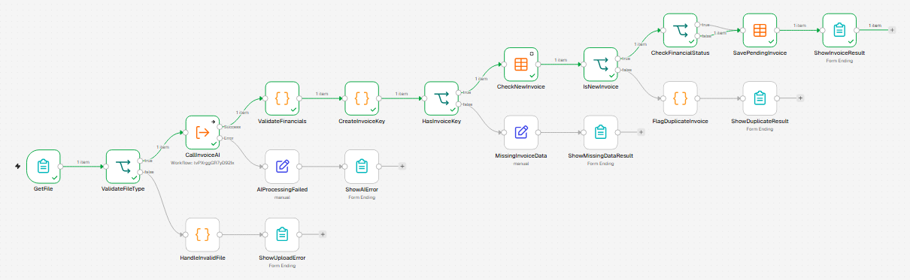
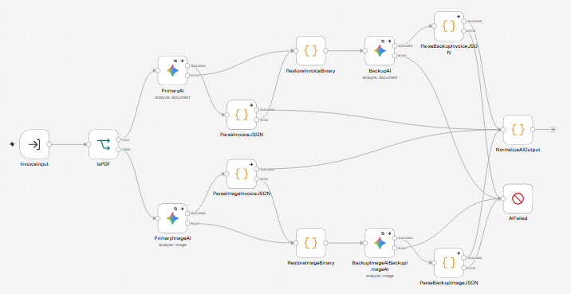

# Architecture and data flow

[Back to README](../README.md)

## Design goal

Separate changing AI-provider logic from deterministic accounting checks and document registration. The supplied system consists of **two distinct n8n workflow exports**. Neither is nested inside the other's JSON file.

## Main workflow (19 nodes in the supplied export)



1. `GetFile` receives one invoice as `binary.invoice_file` through n8n Form Trigger.
2. `ValidateFileType` checks reported MIME type, extension, and `bytes <= 10 * 1024 * 1024`.
3. Invalid files route through `HandleInvalidFile` and `ShowUploadError`.
4. `CallInvoiceAI` calls the separate extraction engine; its failure output routes to `AIProcessingFailed` and `ShowAIError`.
5. `ValidateFinancials` checks numeric line totals, subtotal, and subtotal + tax, and records an array of issues.
6. `CreateInvoiceKey` uses normalized supplier name and invoice number.
7. `HasInvoiceKey` rejects missing identity to a message-only review route.
8. `CheckNewInvoice` checks `InvoiceRegistry` for existing keys; `IsNewInvoice` routes accordingly.
9. New rows pass through `CheckFinancialStatus` and `SavePendingInvoice`, then `ShowInvoiceResult`; duplicates route through `FlagDuplicateInvoice` and `ShowDuplicateResult`.

**No approval decision is executed here.** `approval_status` remains `pending_review` on newly inserted records. A mismatch can still be registered as pending with `validation_status=needs_review`.

## AI engine (14 nodes in the supplied export)



- `InvoiceInput` accepts the caller's item, including binary data.
- `IsPDF` directs PDF to `PrimaryAI` (Analyze Document), image to `PrimaryImageAI` (Analyze Image).
- Each primary has configured retry and an error output. Failure of the primary node or of its parser goes via `RestoreInvoiceBinary` / `RestoreImageBinary` to the corresponding backup.
- `ParseInvoiceJSON`, `ParseBackupInvoiceJSON`, `ParseImageInvoiceJSON`, and `ParseBackupImageJSON` parse `content.parts[0].text` using `JSON.parse`.
- All four successful parse paths converge at `NormalizeAIOutput`.
- A failed backup or parser reaches `AIFailed` (`Stop And Error`), propagating to the main workflow's AI failure handler.

**Current model configuration from the exports:** primary `models/gemini-3.5-flash-lite`; backup `models/gemini-3.5-flash`; both share the Google Gemini credential type. These model IDs are configurable and not a provider-independent failover implementation.

## Extraction contract (observed fields)

```json
{
  "supplier_name": "Atlas Office Supplies",
  "invoice_number": "INV-2026-1042",
  "invoice_date": "2026-11-15",
  "currency": "EGP",
  "subtotal": 7000,
  "tax": 980,
  "total": 7980,
  "items": [
    {"description": "A4 Printer Paper / ...", "quantity": 10, "unit_price": 185, "line_total": 1850}
  ]
}
```

The example shows only one abbreviated item to explain the contract; it is **not** a full invoice payload. The AI prompt allows `null` when a field is absent. A future typed schema validator should check required properties, numeric ranges, dates, currency codes, and item integrity before storage.

## Known architectural gaps

- `InvoiceRegistry` is used as a light demonstration register, not a concurrency-safe accounting ledger.
- The parent and sub-workflow references must be re-bound after import; individual JSON files are exported separately.
- The workflow does not persist the original PDF/image in permanent archival storage or retain a traceable original-document hash.
- The current input is one file per form submission, not a bulk invoice processing pipeline.
- The parent form has no dedicated authenticated external access layer in this export.

More details: [technical review](technical-review.md), [security](deployment-and-security.md), [customization](customization-options.md).
